# MeongID — Dokumentasi End-to-End

Dokumentasi lengkap MeongID: dari visi produk, arsitektur, alur pengguna, skema
database, referensi API, sampai cara menjalankan & memverifikasi. Semua isi
dokumen ini diverifikasi langsung dari kode di repositori ini.

- Demo cepat: `docker compose up -d --build` → buka `http://localhost:5173`
- Akun demo: `demo@meong.test` / `meong123` (terisi otomatis lewat tombol "Coba akun demo")

---

## Daftar isi

1. [Ringkasan produk](#1-ringkasan-produk)
2. [Fitur per modul](#2-fitur-per-modul)
3. [Tangkapan layar](#3-tangkapan-layar)
4. [Arsitektur & teknologi](#4-arsitektur--teknologi)
5. [Alur end-to-end](#5-alur-end-to-end)
6. [Skema database](#6-skema-database)
7. [Referensi API](#7-referensi-api)
8. [Upload foto](#8-upload-foto)
9. [Freemium & upgrade](#9-freemium--upgrade)
10. [PWA (installable)](#10-pwa-installable)
11. [Struktur folder](#11-struktur-folder)
12. [Menjalankan aplikasi](#12-menjalankan-aplikasi)
13. [Konfigurasi](#13-konfigurasi)
14. [Pengujian & verifikasi](#14-pengujian--verifikasi)
15. [Keamanan & isolasi data](#15-keamanan--isolasi-data)

---

## 1. Ringkasan produk

**MeongID** adalah aplikasi web (PWA) manajemen hewan peliharaan untuk *pet
parents* Indonesia. Ide intinya: semua kebutuhan administratif & kesehatan
hewan kesayangan di satu tempat — bukan sekadar galeri foto.

Lima pilar fitur:

| Pilar | Masalah yang dijawab |
| --- | --- |
| **Profil hewan terpadu** | Data dasar, medis (alergi, gol. darah, cip), catatan darurat tersimpan rapi |
| **Pengingat pintar** | Vaksin/obat cacing/obat kutu/grooming tidak terlewat; pengulangan berkala otomatis maju setelah selesai |
| **Digital Pet Passport (QR)** | Kalau hewan hilang & ditemukan orang lain, pemilik bisa dihubungi + info alergi terbaca tanpa login |
| **Pet Expense Tracker** | Tahu berapa pengeluaran bulanan untuk hewan, per kategori |
| **Jurnal tumbuh kembang** | Grafik berat badan + galeri foto per hewan |

Model bisnis: **freemium** — paket Gratis maksimal 2 hewan, paket Premium
simulasi (tanpa payment gateway di versi demo) membuka hewan tanpa batas.

---

## 2. Fitur per modul

### 2.1 Akun & autentikasi
- Daftar akun (nama, email, password — minimal 6 karakter), login dengan JWT (`Authorization: Bearer <token>`, berlaku 30 hari).
- Profil akun: ubah nama & telepon (dipakai sebagai kontak darurat di paspor publik).
- Akun demo ter-seed otomatis: `demo@meong.test` / `meong123`.

### 2.2 Rumah (Beranda)
- Sapaan + tanggal hari ini (Bahasa Indonesia), kartu ringkasan: jumlah hewan / batas paket, total pengeluaran bulan ini, jumlah pengingat aktif (termasuk badge "terlambat").
- Banner upgrade bila slot hewan paket Gratis sudah penuh.
- Daftar 5 pengingat terdekat (terlambat dulu), lalu hewan kesayangan.

### 2.3 Hewan
- Daftar hewan dengan foto profil (atau emoji spesies bila belum ada foto), ras, umur, berat terakhir, jumlah pengingat aktif & foto galeri.
- Tambah/edit/hapus hewan: nama, spesies, ras, tanggal lahir, jenis kelamin, berat, golongan darah, alergi, nomor cip, catatan darurat, foto profil (upload).
- Hapus hewan juga membersihkan file foto fisiknya (profil + galeri).

### 2.4 Detail hewan — 4 tab
- **Profil** — identitas, fisik & medis, catatan darurat, tombol Paspor / Edit / Hapus.
- **Berat** — grafik tren berat (SVG + animasi), form "Timbang sekarang", riwayat, hapus log. Berat terakhir otomatis menjadi `pets.berat_badan_kg`.
- **Galeri** — grid foto tumbuh kembang + keterangan, upload & hapus.
- **Pengingat** — daftar pengingat hewan tersebut, tandai selesai, edit, hapus.

### 2.5 Pengingat
- Jenis: vaksin, obat cacing, obat kutu, grooming, lainnya.
- Pengulangan: sekali saja (`ulang_hari` kosong) atau berkala N hari (1–3650).
- Menandai "selesai": pengingat berkala otomatis dijadwalkan ulang ke `tanggal_jadwal + ulang_hari` dan tetap aktif; pengingat sekali-pakai dinonaktifkan (`aktif = false`).
- Tab: **Akan datang** (dikelompokkan otomatis: Terlambat → Hari ini → Minggu ini → Nanti), **Selesai**, **Semua**.

### 2.6 Pengeluaran
- Catat pengeluaran: kategori (makanan, pasir/perlengkapan, medis/vaksin, grooming, lainnya), keterangan, nominal, tanggal, opsional dikaitkan ke hewan tertentu.
- Ringkasan bulan berjalan: total + bar chart per kategori + daftar transaksi + hapus.

### 2.7 Digital Pet Passport
- Setiap hewan punya `token_publik` (UUID unik, dibuat otomatis oleh database).
- Dari aplikasi: tombol **Paspor** menampilkan QR + tautan; ada aksi Salin / Bagikan / Buka.
- Halaman publik `/passport/:token` — **tanpa login**: identitas hewan, berat terakhir, golongan darah, nomor cip, peringatan alergi, catatan darurat, riwayat vaksin, dan ajakan menghubungi pemilik.
- Cocok ditempel di kandang/tas carrier: siapa pun yang menemukan hewan bisa langsung tahu kontaknya.

### 2.8 Pengaturan
- Kartu paket (Gratis/Premium) + tombol upgrade/downgrade simulasi.
- Kartu "Pasang aplikasi" (PWA).
- Info aplikasi & tombol keluar.

---

## 3. Tangkapan layar

Semua tangkapan layar diambil dari build produksi Docker (mobile 390×844 @2x,
desktop 1440×900) — lihat [cara mengambil ulang](#143-mengambil-ulang-tangkapan-layar).

### Mobile

| Masuk | Beranda | Hewan |
| --- | --- | --- |
| 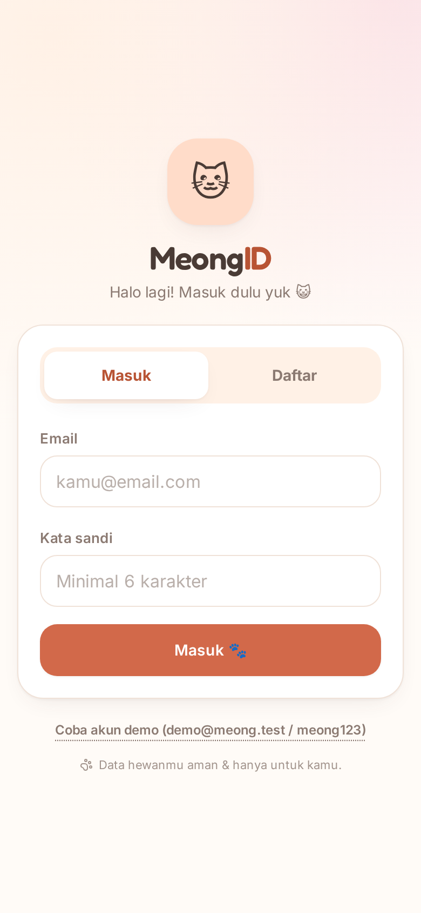 | 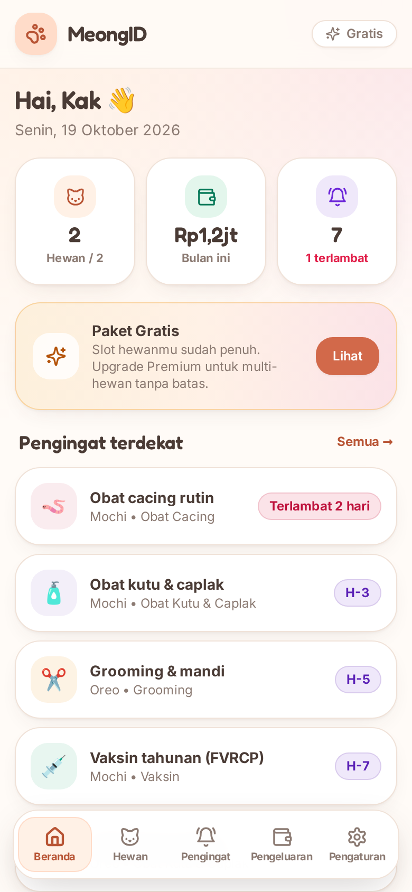 | 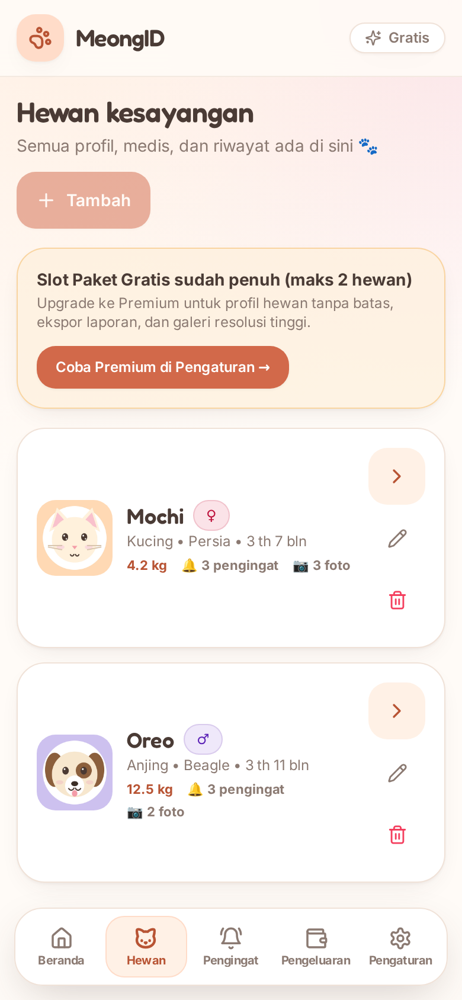 |

| Detail — Profil | Detail — Berat | Detail — Galeri |
| --- | --- | --- |
| 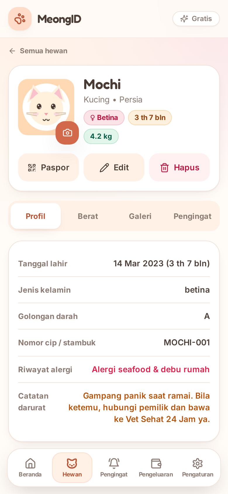 | 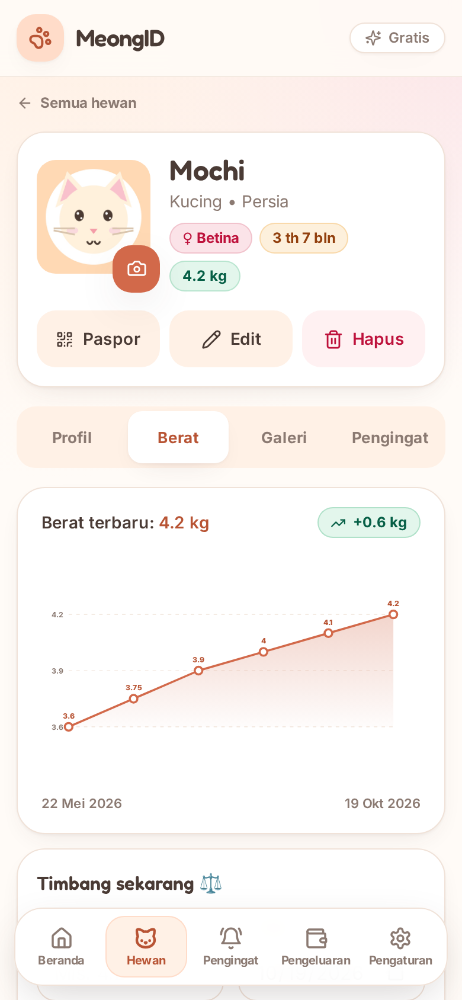 | 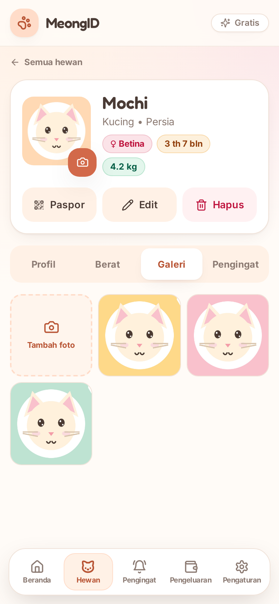 |

| Detail — Pengingat | QR Paspor | Paspor publik |
| --- | --- | --- |
| 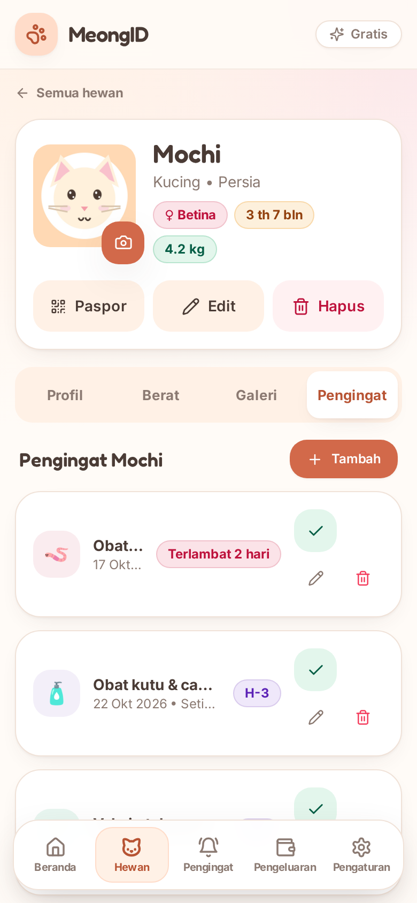 | 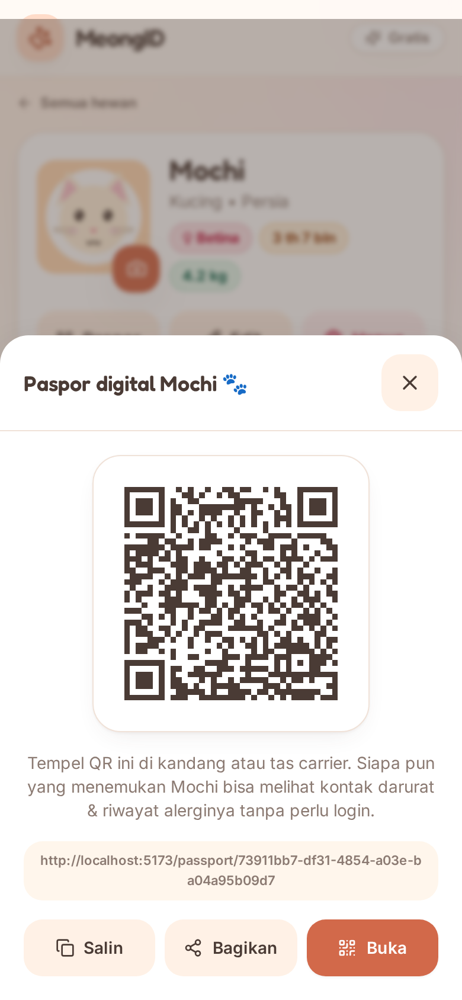 | 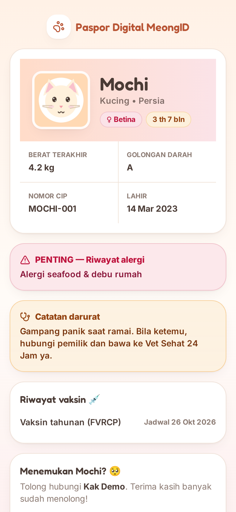 |

| Pengingat | Pengeluaran | Pengaturan |
| --- | --- | --- |
| 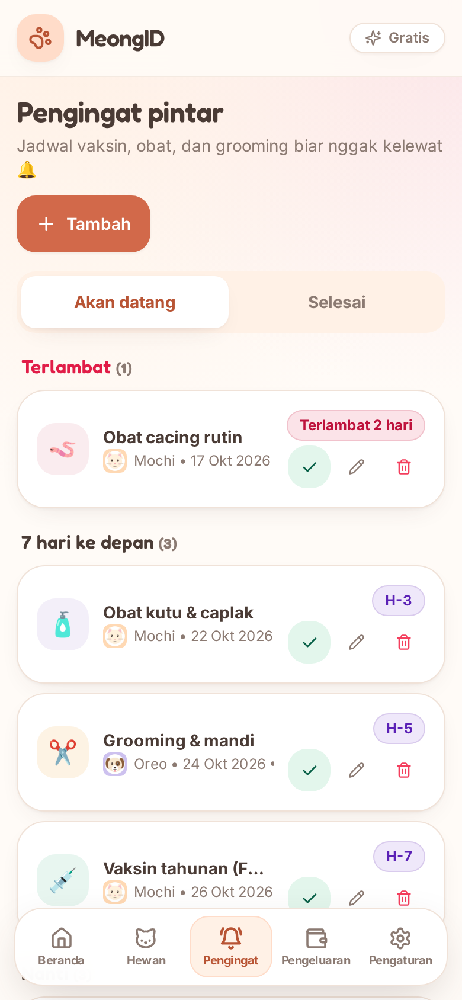 | 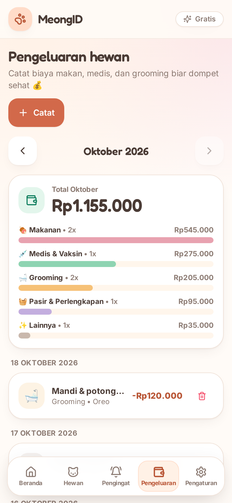 | 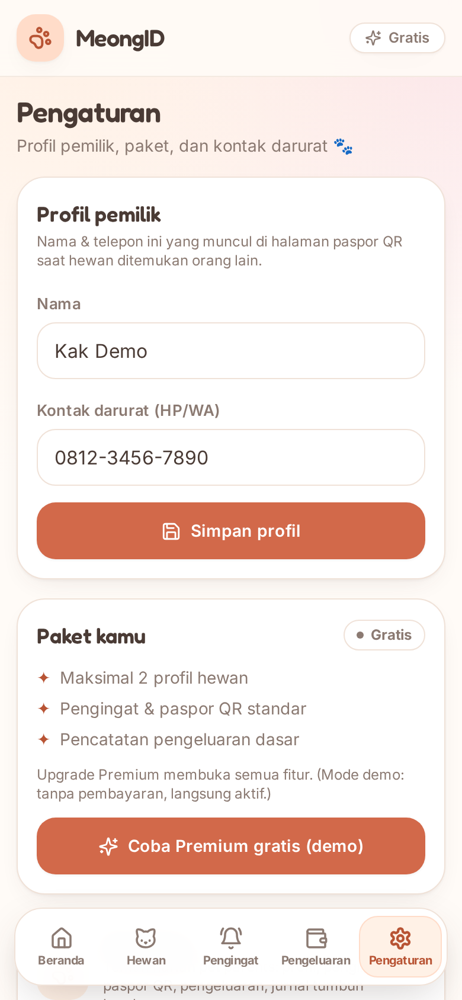 |

### Desktop

| Beranda | Detail hewan | Pengeluaran |
| --- | --- | --- |
| 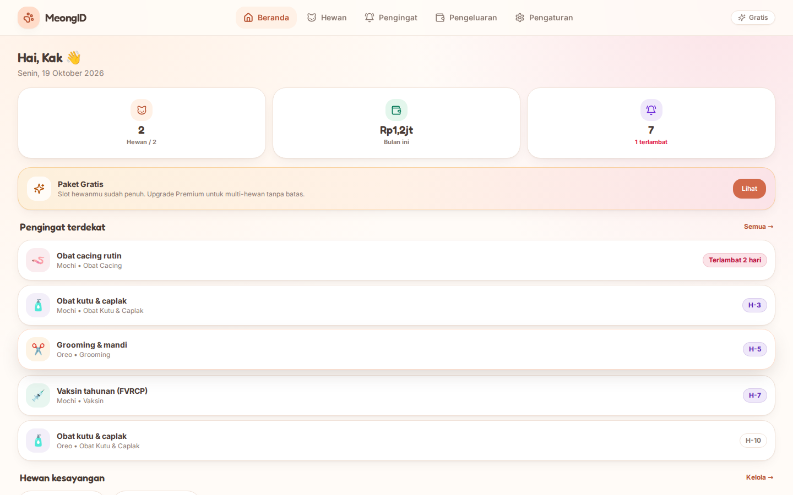 | 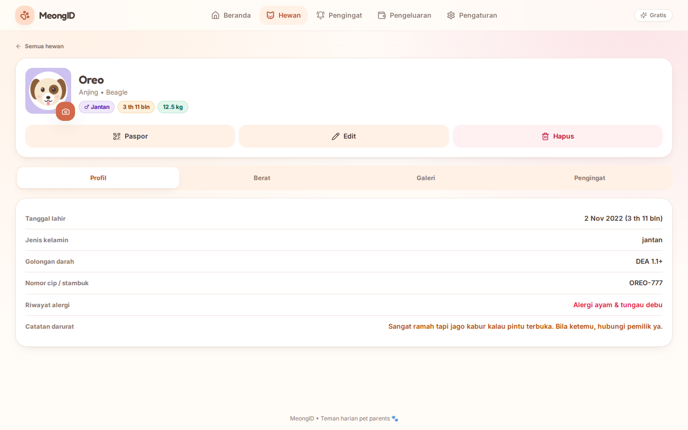 | 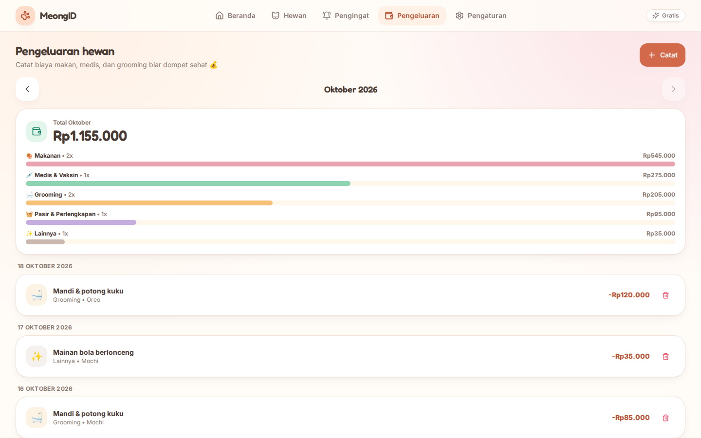 |

---

## 4. Arsitektur & teknologi

```
                         Docker network (meongid_default)
 ┌────────────┐   HTTP    ┌───────────────────────┐   /api/*    ┌─────────────────┐   SQL   ┌──────────────┐
 │  Browser    │ ────────▶ │  nginx (frontend)     │ ──────────▶ │  Express 4      │ ──────▶ │ PostgreSQL 16│
  │  (PWA)      │           │  :80 → host :5173     │             │  :3005          │         │  container   │
 └────────────┘           │  - SPA fallback       │   /uploads  │  - migrasi+seed │         └──────────────┘
                          │  - proxy /api,/uploads│ ──────────▶ │  - JWT + REST   │         volume: pgdata
                          └───────────────────────┘             │  - upload foto  │
                                konten statis: dist/            └─────────────────┘
                                + manifest + sw.js                    volume: uploads
```

- **API satu origin.** `VITE_API_URL` default kosong → frontend memanggil `/api/...` di origin yang sama. Di Docker, nginx mem-proxy ke `backend:3005`; di dev, Vite dev server yang mem-proxy. Efeknya: aplikasi jalan apa adanya di `localhost` maupun via tunnel (ngrok) tanpa ubah konfigurasi.
- **Tanpa ORM.** Backend memakai `pg` + file SQL migrasi berurutan di `db/migrations/`, dijalankan otomatis setiap backend start (idempoten), lalu seed demo (idempoten, hanya jika akun demo belum ada).
- **Data terpisah dari container.** PostgreSQL → volume `pgdata`; file foto → volume `uploads`. Backend di-restart/build tanpa kehilangan data.

| Lapisan | Teknologi |
| --- | --- |
| Frontend | React 18, Vite 5, Tailwind CSS 3, React Router 6, Framer Motion, Recharts, lucide-react |
| Backend | Node.js, Express 4, `pg`, `jsonwebtoken`, `bcryptjs`, `multer`, `express-validator` |
| Database | PostgreSQL 16 (UUID `pgcrypto`, `citext`, enum untuk tier/jenis/kategori) |
| Infrastruktur | Docker Compose (db + backend + frontend/nginx), volume persisten |
| PWA | manifest + service worker (app-shell offline dasar), installable di Android/iOS/desktop |

---

## 5. Alur end-to-end

### 5.1 Perjalanan pertama kali
```
1. Buka /masuk → daftar (nama, email, password ≥6) atau "Coba akun demo"
2. Mendarat di /beranda → kartu ringkasan + banner upgrade jika slot penuh
3. /hewan → "Tambah hewan" → isi profil (berat awal otomatis menjadi log berat pertama)
4. /hewan/:id → unggah foto profil & foto galeri
5. /pengingat → tambah vaksin/obat cacing/grooming (+ pengulangan N hari)
6. /pengeluaran → catat pembelian makanan/pasir/vaksin
7. Buka tab Berat → timbang rutin → grafik tumbuh kembang terbentuk
```

### 5.2 Siklus pengingat berkala
```
tambah pengingat "Obat kucing, ulang 90 hari"
        │
        ▼
[terlambat] ← tanggal_jadwal lewat ── mau tandai "Selesai"?
        │                                  │
        │ ya                               │ ya
        ▼                                  ▼
POST /api/reminders/:id/selesai
        │
        ├── ulang_hari NULL  → aktif=false (pengingat tamat)
        └── ulang_hari N     → tanggal_jadwal = tanggal_jadwal + N hari, tetap aktif
```

### 5.3 Paspor digital dari scan sampai kontak
```
Pemilik: Detail hewan → Paspor → QR tampil → cetak/tempel di tas carrier
                                          │ (tautan berisi token_publik)
Penemu : scan QR → buka /passport/:token  → lihat alergi + catatan darurat
        → telepon/WA pemilik (kontak dari profil akun)
        → kesehatan hewan aman, pemilik tenang 🐾
```

---

## 6. Skema database

6 migrasi berurutan (`db/migrations/001–006`). Semua PK `UUID` (`gen_random_uuid()`),
semua tabel anak memakai `ON DELETE CASCADE` (kecuali `expenses.pet_id` → `SET NULL`).

```
users 1───n pets 1───n reminders
  │            ├───n weight_logs
  │            ├───n gallery_photos
  └───n expenses (pet_id opsional)
```

| Tabel | Kolom penting | Catatan |
| --- | --- | --- |
| `users` | nama, email `CITEXT UNIQUE`, password_hash (bcrypt), telepon, `tier ENUM('free','premium')`, aktif | email case-insensitive |
| `pets` | user_id, nama, spesies (default "Kucing"), ras, tanggal_lahir, jenis_kelamin ENUM, berat_badan_kg (0–200), golongan_darah, alergi, nomor_cip, catatan_darurat, foto_url, `token_publik UUID UNIQUE` | token paspor dibuat DB |
| `reminders` | pet_id, judul, jenis ENUM(vaksin, obat_cacing, obat_kutu, grooming, lainnya), tanggal_jadwal, ulang_hari (1–3650, NULL=sekali), catatan, aktif, selesai_pada | index `(user_id, tanggal_jadwal)` |
| `expenses` | pet_id (nullable), kategori ENUM(makanan, pasir_perlengkapan, medis_vaksin, grooming, lainnya), keterangan, jumlah >0, tanggal | index `(user_id, tanggal)` |
| `weight_logs` | pet_id, berat_kg (0–200), tanggal, catatan | `pets.berat_badan_kg` di-refresh dari log terbaru |
| `gallery_photos` | pet_id, file_url, keterangan, tanggal | file fisik di volume `uploads`, DB hanya simpan URL |

Aturan turunan yang dijaga backend:
- `pets.berat_badan_kg` selalu disinkronkan dari `weight_logs` terbaru (tambah/hapus log).
- Pengingat berkala "selesai" → jadwal otomatis + `ulang_hari`; sekali-pakai → nonaktif.
- Hapus pet → seluruh reminder/log/foto DB ikut (CASCADE) + file fisik foto dihapus dari volume.

---

## 7. Referensi API

Semua respons JSON. Sukses memakai data langsung (`{ hewan: [...] }` dsb.), error
berformat `{ pesan: "..." }` (+ `kode` untuk kasus khusus) dengan pesan Bahasa Indonesia yang humanis.

### Autentikasi

| Method | Endpoint | Body/Query | Keterangan |
| --- | --- | --- | --- |
| POST | `/api/auth/register` | `{nama, email, password}` | Daftar akun → `{token, pengguna}` |
| POST | `/api/auth/login` | `{email, password}` | Login → `{token, pengguna}` |
| GET | `/api/auth/me` | — | Profil dari token |
| PUT | `/api/auth` | `{nama?, telepon?}` | Ubah profil |
| POST | `/api/auth/upgrade` | — | Simulasi jadi Premium |
| POST | `/api/auth/downgrade` | — | Kembali ke Gratis |

### Hewan

| Method | Endpoint | Body/Query | Keterangan |
| --- | --- | --- | --- |
| GET | `/api/pets` | — | `{hewan:[...], tier, batas_hewan}` |
| POST | `/api/pets` | `{nama, spesies?, ras?, tanggal_lahir?, jenis_kelamin?, berat_badan_kg?, golongan_darah?, alergi?, nomor_cip?, catatan_darurat?}` | 403 `BATAS_FREE` bila Gratis sudah 2 hewan |
| GET | `/api/pets/:id` | — | Detail + statistik |
| PUT | `/api/pets/:id` | field sama seperti POST (parsial) | Ubah profil |
| DELETE | `/api/pets/:id` | — | Hapus hewan + file fotonya |
| POST | `/api/pets/:id/foto` | multipart `foto` | Ganti foto profil |
| GET | `/api/pets/:id/weights` | — | Riwayat berat |
| POST | `/api/pets/:id/weights` | `{berat_kg, tanggal?, catatan?}` | Tambah log + sinkron `berat_badan_kg` |
| DELETE | `/api/pets/:id/weights/:wid` | — | Hapus log + sinkron ulang |
| GET | `/api/pets/:id/galeri` | — | Daftar foto galeri |
| POST | `/api/pets/:id/galeri` | multipart `foto` (+`keterangan?`, `tanggal?`) | Tambah foto galeri |
| DELETE | `/api/pets/:id/galeri/:gid` | — | Hapus foto galeri + file fisik |

### Pengingat, pengeluaran, dashboard, paspor

| Method | Endpoint | Body/Query | Keterangan |
| --- | --- | --- | --- |
| GET | `/api/reminders` | `?status=mendatang\|selesai\|semua` (default `mendatang`), `?pet_id=` opsional | Daftar pengingat user |
| POST | `/api/reminders` | `{pet_id, judul, jenis?, tanggal_jadwal, ulang_hari?, catatan?}` | `ulang_hari` NULL/omitted = sekali |
| PUT | `/api/reminders/:id` | parsial | Ubah pengingat |
| POST | `/api/reminders/:id/selesai` | — | Selesai → auto-maju / nonaktif |
| DELETE | `/api/reminders/:id` | — | Hapus |
| GET | `/api/expenses` | `?bulan=YYYY-MM` atau `?dari=&sampai=` (YYYY-MM-DD) | Ringkasan + daftar transaksi |
| POST | `/api/expenses` | `{kategori?, keterangan?, jumlah, tanggal?, pet_id?}` | Catat pengeluaran |
| DELETE | `/api/expenses/:id` | — | Hapus |
| GET | `/api/dashboard` | — | Ringkasan beranda |
| GET | `/api/passport/:token` | — | **Publik** (tanpa auth) data paspor hewan |
| GET | `/health` | — | Health check backend |

### Contoh curl

```bash
# login
TOKEN=$(curl -s -X POST http://localhost:5173/api/auth/login \
  -H 'Content-Type: application/json' \
  -d '{"email":"demo@meong.test","password":"meong123"}' | jq -r .token)

# daftar hewan
curl -s http://localhost:5173/api/pets -H "Authorization: Bearer $TOKEN"

# tambah pengingat vaksin, ulang 365 hari
curl -s -X POST http://localhost:5173/api/reminders \
  -H "Authorization: Bearer $TOKEN" -H 'Content-Type: application/json' \
  -d '{"pet_id":"<uuid>","judul":"Vaksin rabies tahunan","jenis":"vaksin","tanggal_jadwal":"2026-11-01","ulang_hari":365}'

# catat pengeluaran
curl -s -X POST http://localhost:5173/api/expenses \
  -H "Authorization: Bearer $TOKEN" -H 'Content-Type: application/json' \
  -d '{"kategori":"makanan","keterangan":"Royal Canin 2 kg","jumlah":285000}'

# paspor publik (tanpa token)
curl -s http://localhost:5173/api/passport/<token_publik>
```

---

## 8. Upload foto

- Endpoint: `POST /api/pets/:id/foto` dan `POST /api/pets/:id/galeri`.
- Multipart form-data, nama field **`foto`**, satu file per request.
- Tipe diizinkan: JPG, PNG, WEBP, GIF. Maksimal **5 MB** (lebih → 400 "Foto terlalu besar. Maksimal 5 MB ya 📷").
- File disimpan dengan nama UUID di volume `uploads` (container: `/app/uploads`, host: volume `uploads`), disajikan backend di `/uploads/<file>` (di-proxy nginx pada origin yang sama).
- Saat foto diganti/dihapus, file lama ikut dihapus dari volume — tidak menumpuk.

---

## 9. Freemium & upgrade

| | Gratis | Premium (simulasi) |
| --- | --- | --- |
| Profil hewan | maks 2 | tanpa batas |
| Semua fitur lain (pengingat, paspor, pengeluaran, galeri, PWA) | ✅ | ✅ |

- Dibatasi di backend: `POST /api/pets` → 403 `BATAS_FREE` bila tier free sudah 2 hewan.
- Beranda menampilkan banner upgrade saat slot penuh; Pengaturan punya kartu paket.
- `POST /api/auth/upgrade` / `downgrade` menyimulasikan perubahan tier tanpa payment gateway — cukup untuk demo portofolio; di produksi tinggal dihubungkan ke webhook payment.

---

## 10. PWA (installable)

- `frontend/public/manifest.webmanifest` — nama, ikon (192/512 + maskable), `display: standalone`, warna tema cream, plus shortcut cepat "Pengingat" & "Catatan pengeluaran" (klik-kanan ikon di desktop).
- `frontend/public/sw.js` — service worker:
  - navigasi: network-first, fallback app-shell (`/index.html`) saat offline;
  - aset same-origin (JS/CSS/ikon/foto uploads): cache-first;
  - API & lintas-origin: selalu network (tidak pernah di-cache).
- `frontend/src/pwa.js` — registrasi SW hanya di produksi, menangkap `beforeinstallprompt`, auto-update SW.
- Kartu "Pasang aplikasi" di Pengaturan; iOS Safari dapat panduan "Bagikan → Tambah ke Layar Utama".
- nginx: `.webmanifest` disajikan sebagai `application/manifest+json`, `/sw.js` `Cache-Control: no-cache` agar update langsung terpakai.

---

## 11. Struktur folder

```
MeongID/
├── docker-compose.yml          # 3 service: db, backend, frontend
├── .env.example                # semua nilai default aman untuk lokal
├── db/migrations/              # 001_users … 006_gallery_photos (SQL murni)
├── backend/
│   └── src/
│       ├── index.js            # Express app, /health, static /uploads
│       ├── config/db.js        # pool pg
│       ├── config/migrate.js   # runner migrasi idempoten
│       ├── middleware/auth.js  # verifikasi JWT
│       ├── middleware/upload.js# multer: validasi tipe & 5 MB
│       ├── routes/             # auth, pets, reminders, expenses, dashboard, passport
│       └── seed.js             # akun demo + data contoh (idempoten)
├── frontend/
│   ├── nginx.conf              # SPA fallback + proxy /api,/uploads + MIME PWA
│   ├── public/                 # manifest, sw.js, icons/
│   └── src/
│       ├── pwa.js              # install prompt + registrasi SW
│       ├── api/client.js       # fetch wrapper + token
│       ├── context/AuthContext.jsx
│       ├── components/         # ui.jsx, Header, BottomNav, Modal, form, dll.
│       └── pages/              # Masuk, Beranda, Hewan, HewanDetail, Pengingat,
│                               # Pengeluaran, Pengaturan, Passport (publik)
└── docs/
    ├── DOKUMENTASI.md          # dokumen ini
    └── screenshots/            # tangkapan layar mobile & desktop
```

---

## 12. Menjalankan aplikasi

### 12.1 Docker (cara utama)

```bash
docker compose up -d --build     # build & jalankan db + backend + frontend
# buka http://localhost:5173     (api: :3005, postgres: :5434)
docker compose down              # stop (data tetap tersimpan di volume)
docker compose down -v           # stop + hapus volume (reset total, seed ulang)
```

Saat backend start: migrasi SQL dijalankan berurutan, lalu seed demo dibuat bila
belum ada. Login demo: `demo@meong.test` / `meong123`.

### 12.2 Mode dev (hot reload)

```bash
docker compose up -d db                                  # db saja
cd backend  && npm install && npm run dev                # :3005
cd frontend && npm install && npm run dev                # :5173 (proxy /api ke :3005)
```

### 12.3 Mencoba di HP

Jalankan tunnel HTTPS (mis. `ngrok http 5173`) lalu buka URL tunnel di HP —
tidak ada konfigurasi tambahan karena API memakai origin yang sama. Sekaligus
memungkinkan uji install PWA dari perangkat nyata.

---

## 13. Konfigurasi

Salin `.env.example` → `.env` bila ingin mengubah nilai default (semua sudah ada
default untuk pemakaian lokal):

| Variabel | Default | Fungsi |
| --- | --- | --- |
| `DB_USER` / `DB_PASSWORD` / `DB_NAME` | `meong` / `meong123` / `meongid` | Kredensial PostgreSQL |
| `JWT_SECRET` | `ganti-rahasia-ini-di-production` | **Wajib diganti di produksi** |
| `JWT_EXPIRES_IN` | `30d` | Masa berlaku token |
| `SEED_DEMO_EMAIL` / `SEED_DEMO_PASSWORD` | `demo@meong.test` / `meong123` | Akun demo seed |
| `VITE_API_URL` | (kosong) | Kosong = API satu origin via proxy; isi hanya bila frontend-backend beda host |

---

## 14. Pengujian & verifikasi

### 14.1 Smoke test (40 pemeriksaan otomatis)

Skrip Node murni yang menguji alur end-to-end lewat API + halaman SPA:
daftar → login → batas 2 hewan (403 `BATAS_FREE`) → upgrade → tambah hewan ke-3 →
edit → pengingat berkala + "selesai" auto-maju → pengeluaran + ringkasan →
timbang + sinkron berat → upload foto profil & galeri → paspor publik → isolasi
antar akun (akun lain tidak bisa lihat/edit data) → logout/redirect.

Hasil terakhir: **40/40 lulus**.

### 14.2 Verifikasi manual cepat

1. `docker compose up -d --build` → buka `http://localhost:5173` → klik "Coba akun demo".
2. Beranda menampilkan 2 hewan (Mochi & Oreo), total pengeluaran bulan ini, 7 pengingat (1 terlambat).
3. Detail Mochi → tab Berat → grafik 6 titik; tab Galeri → 3 foto.
4. Paspor → QR → buka tautan di jendela incognito → halaman publik tampil tanpa login.
5. Pengaturan → "Pasang aplikasi" (Chrome/Edge) atau panduan iOS.
6. `curl -s http://localhost:3005/health` → `{"status":"sehat","aplikasi":"MeongID"}`.

### 14.3 Mengambil ulang tangkapan layar

`docs/ambil-screenshot.mjs` memakai Playwright (Chromium headless) + akun demo
untuk memotret seluruh halaman (mobile 390×844 @2x & desktop 1440×900):

```bash
# prasyarat: stack Docker jalan & data demo (Mochi + Oreo) ter-seed
cd /tmp/opencode && npm i playwright && npx playwright install chromium
node /var/www/html/portofolio-js/MeongID/docs/ambil-screenshot.mjs  # hasil ke docs/screenshots/
```

Font emoji warna (`fonts-noto-color-emoji`) diperlukan agar emoji tampil di tangkapan layar.

---

## 15. Keamanan & isolasi data

- **Isolasi per akun** dijaga di setiap query: semua endpoint filter `user_id = req.user.id`; akses lintas akun → 404 ("tidak ditemukan di keluarga kamu").
- **JWT** ditandatangani `JWT_SECRET`, diverifikasi middleware `authRequired`; endpoint paspor satu-satunya yang publik (dan hanya mengekspos data medis penting, bukan data akun).
- **Password** di-hash bcrypt (10 rounds), tidak pernah dikembalikan API.
- **Validasi input** ganda: `express-validator` (format) + sanitasi/limit panjang kolom; `body` limit 1 MB; upload dibatasi tipe & 5 MB.
- **Query parameterized** di seluruh backend (`pg`), tanpa string concat SQL.
- **File upload** diberi nama UUID (tidak memakai nama asli), disajikan statis read-only.
- `.env` tidak ikut ter-commit; default aman untuk lokal, `JWT_SECRET` wajib diganti di produksi.
